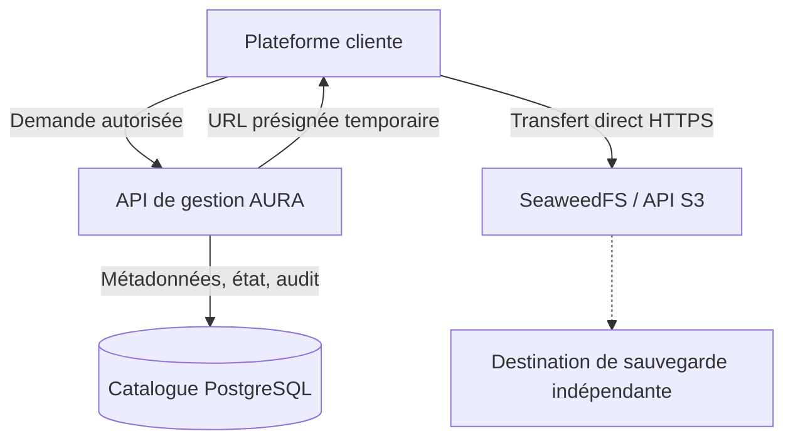
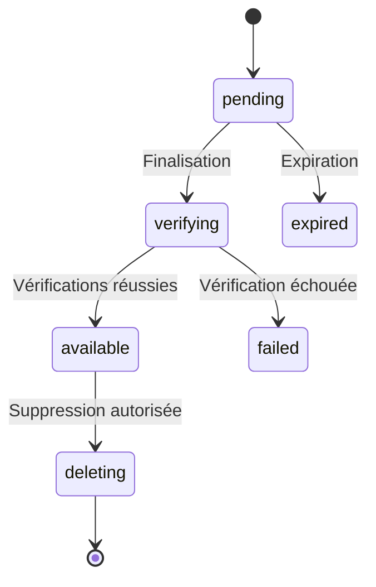

# Déployé ne signifie pas fiable

> Un service accessible n'est pas nécessairement un service fiable. La fiabilité se démontre en vérifiant ce qui arrive aux données lorsque les composants redémarrent, que les transferts échouent ou qu'une dépendance devient indisponible.

## Résumé

Déployer une application consiste à rendre ses composants exécutables dans un environnement donné. La fiabilité exige davantage : comprendre où résident les données, contrôler les accès, vérifier les transferts, prévoir les pannes et démontrer qu'une restauration est possible.

AURA Storage est conçu comme un service de stockage objet indépendant. Sa documentation décrit une architecture initiale composée d'un VPS, Docker Compose, Traefik, SeaweedFS avec une API compatible S3, une API de gestion et un catalogue PostgreSQL. Elle précise également que certains composants et contrôles restent à valider sur le VPS pilote. Une architecture décrite, un composant implémenté et un système validé en conditions réelles ne constituent pas le même niveau de preuve.

## 1. Disponibilité et fiabilité

La disponibilité répond à une question immédiate : le service répond-il maintenant ? La fiabilité pose des questions plus larges :

- Les données survivent-elles à la recréation d'un conteneur ?
- Les transferts interrompus laissent-ils un état cohérent ?
- Les accès sont-ils limités aux ressources autorisées ?
- Peut-on détecter une incohérence entre le stockage et le catalogue ?
- Une sauvegarde peut-elle réellement être restaurée ?
- Le service se comporte-t-il correctement lorsque PostgreSQL ou le stockage devient indisponible ?

Une page de statut verte ne répond pas à toutes ces questions. Elle indique seulement que les contrôles mesurés sont satisfaits à cet instant.

## 2. Comprendre les responsabilités



- La plateforme cliente authentifie son utilisateur et applique ses règles métier.
- L'API AURA authentifie l'application appelante, contrôle son périmètre, crée les intentions de transfert et gère les métadonnées.
- SeaweedFS reçoit ou délivre les octets des objets.
- PostgreSQL conserve le catalogue et les états de transfert, pas les fichiers eux-mêmes.
- La sauvegarde indépendante doit être vérifiée par un exercice de restauration.

Ce découpage évite de faire transiter systématiquement les gros fichiers à travers le processus API. Il impose cependant de coordonner plusieurs opérations qui ne constituent pas une transaction atomique unique.

## 3. Vérifier la persistance

Les conteneurs sont remplaçables. Les données qui doivent survivre à leur recréation doivent être conservées dans des volumes ou des systèmes de stockage persistants correctement configurés.

```bash
docker compose ps
docker compose logs --tail=20
docker volume ls
```

Ces commandes sont des outils d'inspection, pas des preuves suffisantes de fiabilité.

| Vérification | Ce qu'elle montre | Ce qu'elle ne prouve pas |
|---|---|---|
| `docker compose ps` | L'état déclaré des services | La cohérence des données |
| `docker compose logs --tail=20` | Une partie des événements récents | L'absence de toutes les erreurs |
| `docker volume ls` | Les volumes Docker existants | Que les bons volumes sont montés et restaurables |

Un test utile consiste à définir des données contrôlées, vérifier leur état, recréer les composants concernés dans un environnement sûr, puis confirmer que les données attendues sont toujours présentes. Cette opération doit être planifiée pour ne pas perturber des données utiles.

## 4. Gérer explicitement le cycle de vie des transferts

Un transfert implique plusieurs étapes : autorisation, création d'une intention, transfert des octets, vérification puis publication de l'objet dans le catalogue. Ces étapes peuvent échouer indépendamment.

La documentation de transfert d'AURA décrit des états tels que `pending`, `verifying`, `available`, `expired`, `failed`, `quarantined` et `deleting`.



Ce diagramme illustre un modèle de cycle de vie ; les transitions exactes doivent être comparées à l'implémentation actuelle. Un objet ne devrait pas être déclaré disponible sur la seule base d'une confirmation envoyée par le client. La finalisation doit vérifier l'existence de l'objet à la clé générée côté serveur, sa taille réelle et son checksum lorsque celui-ci est exigé.

Les opérations répétées doivent être idempotentes : réessayer une finalisation ne doit pas créer plusieurs objets logiques.

## 5. Protéger les URL présignées

Une URL S3 présignée est une capacité d'accès temporaire. Elle doit être limitée à un objet et à une méthode précis.

- Générer les clés d'objet côté serveur.
- Vérifier le périmètre tenant/application à chaque demande.
- Utiliser des identités de stockage à privilèges minimaux.
- Ne jamais exposer les identifiants d'administration aux clients.
- Ne pas journaliser les URL présignées complètes.
- Garder les interfaces administratives du stockage sur un réseau privé.
- Refuser les accès inter-tenant et inter-application.

La durée de validité doit être choisie selon les conditions réelles de transfert puis testée. Une URL expirée doit conduire à une nouvelle décision d'autorisation.

## 6. Une sauvegarde n'est utile que si la restauration fonctionne

Une sauvegarde peut être incomplète, corrompue, trop ancienne ou conservée dans le même domaine de panne que le système principal. La présence d'une archive ne suffit donc pas.

Une stratégie de restauration doit préciser :
1. quelles données sont sauvegardées ;
2. où la copie est conservée ;
3. comment son intégrité est vérifiée ;
4. comment reconstruire un environnement de restauration ;
5. comment vérifier la cohérence entre métadonnées et objets ;
6. quelle perte de données et quel temps de récupération sont acceptables.

La documentation d'AURA exige une destination de sauvegarde indépendante et une restauration testée avant l'importation de données importantes. Cette exigence ne doit pas être présentée comme satisfaite tant que les preuves d'exécution ne sont pas disponibles.

## 7. Un VPS unique reste un point de défaillance unique

Docker, un reverse proxy et une séparation des composants améliorent l'organisation. Ils ne transforment pas un serveur unique en infrastructure hautement disponible.

Il faut distinguer :

- **Persistance** : les données survivent à certains redémarrages.
- **Sauvegarde** : une copie récupérable existe hors du système principal.
- **Restauration** : une procédure permet de récupérer effectivement les données.
- **Haute disponibilité** : le service peut continuer ou reprendre selon un objectif défini malgré certaines pannes.

Ces propriétés se complètent, mais ne sont pas interchangeables.

## 8. Grille de validation avant production

| Domaine | Preuve attendue |
|---|---|
| HTTPS | Certificat et accès externes vérifiés |
| Réseau | Ports internes et administratifs non exposés |
| Autorisation | Tests négatifs inter-tenant et inter-application |
| URL présignées | Méthode, clé et expiration limitées |
| Transferts | Interruption, répétition et expiration testées |
| Intégrité | Taille et checksum vérifiés selon le contrat |
| Persistance | Données conservées après recréation contrôlée |
| Sauvegarde | Copie indépendante vérifiée |
| Restauration | Exercice documenté et réussi |
| Journaux | Secrets et URL présignées absents des logs |

Cette grille est une proposition de validation, pas une déclaration de réussite.

## Conclusion

La fiabilité ne se déduit ni d'un démarrage réussi ni d'une interface accessible. Elle se construit avec des responsabilités séparées, des états explicites, des contrôles d'accès stricts et des scénarios d'échec vérifiés.

Pour AURA Storage, le principe directeur est de ne jamais confondre l'architecture prévue avec la validation opérationnelle. La prochaine étape crédible consiste à réunir les preuves nécessaires : HTTPS, isolation réseau, persistance, comportement des transferts et restauration indépendante.

> **Principe à retenir :** ce qui n'a pas été vérifié doit rester une hypothèse, pas devenir une promesse de fiabilité.

## Références

- [Architecture AURA Storage](https://github.com/digitaleflex/aura-storage/blob/main/docs/ARCHITECTURE.md)
- [Contrat de transfert de fichiers](https://github.com/digitaleflex/aura-storage/blob/main/docs/FILE-TRANSFER.md)
- [Dépôt AURA Storage](https://github.com/digitaleflex/aura-storage)

**Statut éditorial :** brouillon à relire après vérification de l'implémentation et des preuves de tests. Les commandes et diagrammes sont illustratifs ; ils ne constituent pas des résultats d'exécution.
