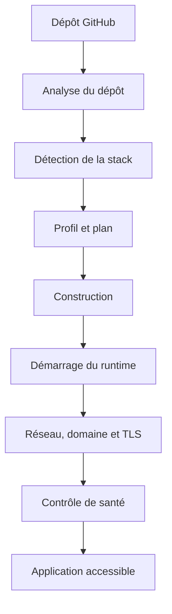

# Des modules fonctionnels ne garantissent pas un produit fonctionnel

> Un composant peut être correct lorsqu'il est testé seul, sans être appelé par le système qui devrait l'utiliser.

## Résumé

Les tests unitaires vérifient le comportement d'une fonction ou d'un module dans un périmètre contrôlé. Ils ne démontrent pas, à eux seuls, que l'application relie correctement ses composants, transmet les bonnes données et termine son parcours métier.

Axiom vise à transformer un dépôt GitHub en application déployée. Son parcours cible comprend l'analyse du dépôt, la détection de la stack, la préparation d'un plan, la construction, l'exécution, le routage, la configuration du domaine et du TLS, puis les contrôles de santé.

La documentation du dépôt distingue les parties du parcours reliées au moteur de celles qui restent à connecter. Elle fournit un exemple du problème d'intégration : des composants de build et d'exécution peuvent exister et disposer de tests sans être construits par le point de composition de l'application. Ce constat doit être revérifié sur la version actuelle avant publication.

## 1. Les tests ne répondent pas tous à la même question

| Niveau | Question | Exemple |
|---|---|---|
| Unitaire | Ce composant fonctionne-t-il isolément ? | Le planificateur produit-il un plan valide ? |
| Intégration | Plusieurs composants collaborent-ils correctement ? | Le moteur transmet-il les bonnes dépendances au composant de build ? |
| Contrat | Les composants respectent-ils les formats convenus ? | Un événement respecte-t-il le schéma attendu ? |
| Bout en bout | Le parcours métier fonctionne-t-il ? | Une application déployée est-elle réellement accessible ? |

Ces niveaux se complètent. Un test de bout en bout peut détecter une rupture de parcours, mais il est souvent moins précis pour localiser la cause. À l'inverse, une suite unitaire rapide ne garantit pas que les composants sont assemblés correctement.

## 2. Rendre le parcours observable



Chaque flèche représente une relation à vérifier. La présence des blocs dans le dépôt ne suffit pas : il faut confirmer que le composant amont appelle le suivant, transmet les données attendues et gère les erreurs.

La création d'un enregistrement de déploiement n'est pas équivalente au démarrage de l'application. Le système doit distinguer un déploiement en attente, un déploiement en échec et un déploiement réellement accessible.

## 3. Le point de composition est critique

Dans une application modulaire, les composants sont généralement construits et reliés dans un point de composition, parfois appelé *composition root* ou bootstrap. Ce code détermine quelles implémentations sont réellement utilisées et comment leurs dépendances sont fournies.

Exemple pédagogique simplifié :

```go
type Builder interface {
    Build(ctx context.Context, app Application) (Artifact, error)
}

type Runner interface {
    Start(ctx context.Context, artifact Artifact) error
}

type Engine struct {
    builder Builder
    runner  Runner
}

func NewEngine(builder Builder, runner Runner) *Engine {
    return &Engine{builder: builder, runner: runner}
}
```

Cet extrait illustre l'injection de dépendances ; il ne représente pas le code exact d'Axiom.

Même si `Builder` et `Runner` possèdent chacun des tests unitaires satisfaisants, le système ne les utilisera pas si le bootstrap ne les construit pas ou ne les transmet pas à l'Engine. Le défaut se situe alors dans l'assemblage, pas nécessairement dans les modules.

## 4. Distinguer code livré, testé et opérationnel

- **Livré** : le code existe dans le dépôt.
- **Testé isolément** : les tests associés ont été exécutés et ont produit les résultats attendus.
- **Relié au système** : le runtime construit le composant et l'appelle dans le parcours réel.
- **Validé de bout en bout** : un scénario complet a été exécuté avec un résultat observable.

Il faut éviter de dire qu'une fonctionnalité est « terminée » lorsque seule une partie du code existe. Une description précise indique ce qui est implémenté, testé, connecté et encore à valider.

## 5. Concevoir un test d'intégration utile

Un test d'intégration doit vérifier une interaction significative. Pour un parcours de déploiement, un scénario pourrait vérifier que :

1. une demande est acceptée par l'API ;
2. un état initial cohérent est créé ;
3. le moteur appelle le composant de construction ;
4. l'artefact est remis au composant d'exécution ;
5. les étapes réseau et routage sont déclenchées ;
6. un contrôle de santé examine le service démarré ;
7. l'état final correspond au résultat observé.

Les dépendances externes peuvent être isolées dans certains tests. Les tests de bout en bout doivent aussi inclure un environnement réaliste pour vérifier les véritables frontières entre composants.

## 6. Tester les échecs

Le chemin heureux ne révèle qu'une partie du comportement. Il faut aussi définir les résultats attendus lorsque :

- le dépôt n'est pas accessible ;
- la détection de stack échoue ;
- la construction retourne une erreur ;
- le runtime ne démarre pas ;
- la configuration réseau est invalide ;
- le domaine ne résout pas vers le bon service ;
- le contrôle de santé expire ;
- une dépendance devient indisponible ;
- une requête ou un événement est répété.

Pour chaque cas, l'application devrait produire un état explicite, une erreur exploitable et des journaux utiles sans exposer de secrets.

## 7. Les événements doivent refléter la réalité

Une interface peut afficher une progression même si le moteur ne publie pas les événements correspondants. L'état présenté doit donc provenir de l'exécution réelle.

Exemple de progression illustrative :

```text
PENDING
   ↓
BUILDING
   ↓
STARTING
   ↓
HEALTH_CHECK
   ↓
LIVE
```

Ce n'est pas une affirmation sur les états exacts d'Axiom. Les transitions doivent être définies et validées dans le code. Le système doit distinguer un événement absent d'un événement signalant un échec.

## 8. Checklist de qualité

- [ ] Le composant possède des tests unitaires pertinents.
- [ ] Le point de composition construit et connecte ce composant.
- [ ] Les interfaces et contrats sont vérifiés.
- [ ] Un test d'intégration couvre la collaboration essentielle.
- [ ] Un parcours de bout en bout couvre le résultat métier.
- [ ] Les échecs produisent un état explicite.
- [ ] Les événements et journaux correspondent au comportement réel.
- [ ] La CI exécute les vérifications essentielles.
- [ ] Les résultats sont documentés pour une version précise.

Cette liste doit être adaptée au risque. Elle ne remplace pas une analyse de sécurité ni des tests de charge lorsqu'ils sont nécessaires.

## Conclusion

La qualité d'un produit dépend de la correction de ses modules, mais aussi de leur assemblage, des contrats qu'ils respectent et de la capacité à vérifier un parcours réel.

Pour un moteur de déploiement comme Axiom, la preuve essentielle est que le système relie correctement les étapes et permet d'observer le résultat final.

> **Principe à retenir :** tester les composants, vérifier leur assemblage et valider le parcours complet.

## Références

- [Dépôt Axiom](https://github.com/digitaleflex/axiom)
- [Documentation du dépôt](https://github.com/digitaleflex/axiom/tree/main/docs)
- [Workflows CI](https://github.com/digitaleflex/axiom/tree/main/.github/workflows)

**Statut éditorial :** brouillon à vérifier sur la version actuelle du dépôt. L'extrait de code et le flux sont illustratifs ; les résultats de tests doivent être datés et reproduits avant publication.
