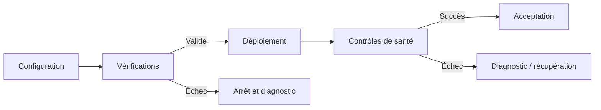

# Automatiser sans perdre le contrôle

> Une bonne automatisation ne réduit pas seulement le nombre d'actions manuelles. Elle rend les opérations répétables, vérifiables et plus faciles à diagnostiquer.

## Résumé

L'automatisation est souvent présentée comme un moyen d'aller plus vite. En infrastructure, sa valeur dépend aussi des garde-fous qui l'entourent : validation des configurations, séparation des réseaux, gestion des secrets, contrôles après déploiement et procédures de récupération.

WPOpsX est une plateforme de déploiement automatisé de WordPress s'appuyant sur Docker et Traefik. Sa documentation décrit des fonctions de déploiement, de gestion TLS, de sauvegarde, de mise à jour et de supervision. Elle présente également un script de vérification destiné à contrôler plusieurs éléments avant l'intégration ou le déploiement.

Cette note examine les principes d'une automatisation contrôlable. Les exemples doivent être interprétés selon le contenu réel du dépôt ; ils ne prouvent pas que chaque scénario a été testé en production.

## 1. Automatiser une opération ne garantit pas sa qualité

Un script peut répéter une procédure avec précision tout en répétant une erreur de configuration. Il faut donc définir ce qui est acceptable avant d'autoriser l'exécution.



Ce schéma représente un modèle général. Les étapes précises et les conditions d'arrêt doivent correspondre à l'implémentation réelle. Les contrôles doivent intervenir avant les opérations risquées, puis après l'exécution pour confirmer le résultat.

## 2. Valider les configurations

WPOpsX documente un script `scripts/verify.sh` destiné à contrôler plusieurs éléments : fichiers YAML, syntaxe Bash, configuration Docker Compose et chargement de la configuration Traefik, selon les outils disponibles.

```bash
./scripts/verify.sh
./scripts/verify.sh --fast
```

Il faut consulter le script pour confirmer exactement les vérifications exécutées dans la version utilisée. Une validation préalable peut détecter des erreurs de syntaxe ou de structure, mais elle ne remplace pas un test d'exécution dans un environnement représentatif.

## 3. Réduire l'exposition réseau

Un principe important de la sécurité d'infrastructure consiste à ne rendre publics que les services qui doivent réellement être accessibles depuis l'extérieur.

WPOpsX documente notamment :
- Traefik pour le routage HTTP/HTTPS ;
- les bases de données sur des réseaux Docker internes ;
- l'absence de ports d'administration directement publiés sur l'hôte ;
- la protection des interfaces d'administration derrière une authentification HTTPS.

Ces choix réduisent la surface d'exposition, mais leur efficacité doit être vérifiée dans les configurations effectivement déployées.

Pour chaque port, une revue devrait identifier le service qui l'écoute, les clients autorisés, son exposition publique ou privée, son mécanisme d'authentification et la preuve que les accès non autorisés sont refusés.

## 4. Traiter les secrets comme des données sensibles

Les secrets ne doivent pas être intégrés directement dans les scripts, les dépôts ou les journaux. Ils doivent être fournis par un mécanisme adapté, avec des permissions restrictives et une procédure de rotation.

La documentation WPOpsX indique que les fichiers `.env` et `traefik/acme.json` sont exclus de Git. Elle précise également que les modules exigent des identifiants explicites plutôt que de démarrer avec des mots de passe par défaut.

Exemple de contrôle de permissions à adapter au fichier concerné :

```bash
chmod 600 .env
```

Cette commande limite les permissions du fichier pour son propriétaire. Elle ne résout pas à elle seule la gestion des secrets : il faut aussi vérifier les sauvegardes, les journaux, les droits système et les possibilités de rotation.

## 5. Vérifier le résultat après déploiement

Un processus de déploiement ne devrait pas s'arrêter à la création des conteneurs. Il doit vérifier que le service est réellement utilisable.

Selon l'application, les contrôles peuvent inclure :
- l'état des conteneurs ;
- la disponibilité de l'endpoint attendu ;
- la validité du certificat TLS ;
- la connectivité entre les services ;
- la présence des données nécessaires ;
- les erreurs récentes dans les journaux.

Un contrôle HTTPS réussi indique que le chemin testé fonctionne au moment de la vérification. Il ne prouve pas que toutes les fonctions métier, toutes les extensions ou toutes les procédures de sauvegarde sont opérationnelles.

## 6. Sauvegarde et restauration

WPOpsX documente une sauvegarde des fichiers et de la base de données, avec une rotation indiquée de sept jours dans le modèle présenté par le dépôt. La documentation mentionne également des tâches planifiées de sauvegarde et de mise à jour.

Une rotation est une politique de conservation, pas une preuve de restauration. Il faut vérifier que les sauvegardes sont créées à la fréquence prévue, que les fichiers sont complets, que les copies sont protégées et qu'une restauration peut être effectuée dans un environnement contrôlé.

Après restauration, le site et sa base doivent être cohérents. Les essais ne doivent pas écraser les données de production.

## 7. Rendre les opérations reproductibles

La reproductibilité repose sur des entrées explicites et des étapes documentées.

- Versionner les configurations non sensibles.
- Documenter les prérequis.
- Séparer configuration et secrets.
- Rendre les erreurs explicites.
- Conserver des journaux utiles sans données confidentielles.
- Définir les conditions de succès et d'échec.
- Tester les chemins de récupération.
- Protéger les opérations destructrices par des garde-fous adaptés.

Les scripts doivent être compréhensibles : les suppressions, les effets sur les volumes et les changements réseau doivent être documentés.

## 8. Checklist opérationnelle

- [ ] Le périmètre du changement est identifié.
- [ ] Les prérequis et configurations sont vérifiés.
- [ ] Les secrets ne sont pas inclus dans le changement.
- [ ] Les ports publics et réseaux internes sont compris.
- [ ] Une procédure de retour arrière existe si nécessaire.
- [ ] Les sauvegardes pertinentes sont récentes et vérifiées.
- [ ] Les contrôles après déploiement sont définis.
- [ ] Les journaux permettent d'identifier l'étape qui échoue.
- [ ] Les effets destructeurs sont signalés et protégés.
- [ ] Le résultat a été vérifié dans l'environnement ciblé.

Cette checklist est un outil de préparation, pas un certificat de sécurité.

## Conclusion

L'automatisation devient une pratique d'ingénierie lorsque ses opérations sont encadrées par des contrôles explicites et que leurs résultats sont observables.

WPOpsX illustre cette approche à travers des scripts de vérification, une séparation des réseaux, une gestion explicite des secrets et des procédures de maintenance. La valeur de ces mécanismes dépend néanmoins de leur exécution effective, de la couverture des scénarios d'échec et de la capacité à restaurer un service.

> **Principe à retenir :** automatiser l'action, mais aussi les vérifications qui permettent de lui faire confiance.

## Références

- [Dépôt WPOpsX](https://github.com/digitaleflex/WPOpsX)
- [Script de vérification](https://github.com/digitaleflex/WPOpsX/blob/main/scripts/verify.sh)
- [Documentation du projet](https://github.com/digitaleflex/WPOpsX/tree/main/docs)

**Statut éditorial :** brouillon à relire avec la version courante des scripts et configurations. Les commandes proviennent de la documentation du projet ; aucun résultat d'exécution n'est affirmé ici.
