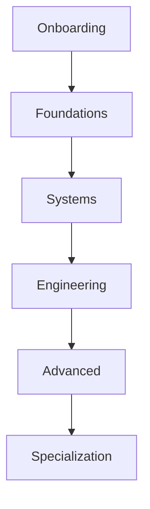
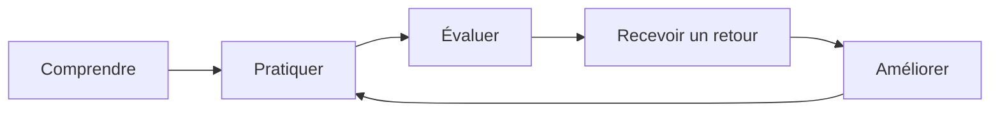

# Apprendre l'ingénierie ne consiste pas à accumuler des tutoriels

> Accumuler des ressources peut donner une impression de progression. Développer une compétence exige aussi de pratiquer, de recevoir un retour et de démontrer ce que l'on sait faire.

## Résumé

Les ressources techniques disponibles sont nombreuses : cours, vidéos, documentations, tutoriels et dépôts d'exemples. Le défi n'est donc pas seulement de trouver du contenu. Il consiste à organiser les apprentissages dans une progression cohérente et à rendre les acquis observables.

HashCode Engineering Foundations (HEF) est présenté dans son dépôt comme le curriculum de base de HashCode pour les nouveaux membres. Sa progression documentée est : **Onboarding → Foundations → Systems → Engineering → Advanced → Specialization**.

Cette structure donne une ossature au parcours. Le README consulté ne suffit toutefois pas à démontrer que toutes les étapes disposent déjà de contenus complets, de critères d'évaluation ou de mécanismes de validation opérationnels. Cette note distingue le principe de conception des éléments qui restent à préciser ou à vérifier.

## 1. Le problème de l'accumulation de ressources

Un apprenant peut terminer plusieurs vidéos sans être capable de reproduire une opération, de diagnostiquer une erreur ou d'expliquer pourquoi une solution convient à un contexte donné.

Il faut distinguer plusieurs activités :

- **Consommer** : lire, regarder ou écouter une explication.
- **Comprendre** : reformuler le concept et expliquer ses relations.
- **Pratiquer** : appliquer le concept dans un environnement contrôlé.
- **Diagnostiquer** : reconnaître une erreur et en rechercher la cause.
- **Concevoir** : choisir une solution en fonction de contraintes explicites.
- **Démontrer** : fournir des éléments observables montrant ce qui a été appris.

Ces activités ne forment pas toujours une progression strictement linéaire, mais elles aident à éviter de confondre temps passé sur une ressource et maîtrise effective.

## 2. Rendre la progression lisible

Le schéma représente la séquence documentée, pas une preuve que chaque transition est déjà automatisée.

Pour rendre chaque étape pédagogiquement utile, elle devrait préciser :
- les connaissances préalables ;
- les objectifs d'apprentissage ;
- les notions essentielles ;
- les exercices et réalisations attendus ;
- les critères de validation ;
- les ressources nécessaires ;
- les limites et prochaines étapes.

Sans ces éléments, la séquence reste une structure de curriculum, mais ne suffit pas à expliquer comment l'apprenant progresse.

## 3. Distinguer connaissance et compétence

Une connaissance peut être évaluée par une explication ou un questionnaire. Une compétence pratique nécessite souvent une tâche observable dans un contexte défini.

Connaître la définition d'un réseau Docker ne démontre pas automatiquement la capacité à concevoir une séparation réseau correcte. Savoir expliquer une sauvegarde ne prouve pas que l'on sait restaurer un système à partir de celle-ci.

| Dimension | Exemple de preuve |
|---|---|
| Compréhension | Explication d'un concept et de ses limites |
| Application | Exercice réalisé dans un laboratoire |
| Diagnostic | Identification et correction d'une erreur |
| Conception | Choix argumenté entre plusieurs options |
| Documentation | Procédure reproductible avec résultats |
| Révision | Amélioration après retour ou revue par un pair |

Ce tableau est une proposition pédagogique, pas une description d'un mécanisme déjà implémenté dans HEF.

## 4. Définir des critères d'acceptation

Une consigne comme « comprendre Docker » est trop vague pour établir si un objectif est atteint.

Un objectif plus vérifiable pourrait être :

> Dans un environnement de laboratoire, déployer deux services avec Docker Compose, expliquer leurs dépendances, vérifier leur connectivité et démontrer que les données devant persister sont conservées après une recréation contrôlée des conteneurs.

Cet objectif précise le contexte, l'action attendue, le résultat observable et une partie des preuves à fournir. Les critères doivent rester adaptés au niveau de l'apprenant.

## 5. La progression ne se résume pas à un score

Les systèmes d'apprentissage utilisent parfois des points, des séries d'activité ou des badges. Ils peuvent rendre les efforts visibles, mais ne mesurent pas directement la compétence.

Un indicateur d'activité peut montrer qu'une personne s'est connectée ou a terminé un exercice. Il ne démontre pas nécessairement qu'elle comprend le sujet ou qu'elle peut réutiliser son apprentissage dans une situation nouvelle.

Une conception plus robuste distingue :
- les traces d'activité ;
- les résultats d'exercices ;
- la qualité des réalisations ;
- la capacité à expliquer ses décisions ;
- la progression observée dans le temps ;
- le niveau de confiance accordé à chaque évaluation.

Si une évaluation repose sur peu de preuves, cette incertitude doit rester visible. Un score unique ne devrait pas masquer les dimensions que le système ne mesure pas.

## 6. Organiser une boucle d'apprentissage

La boucle transforme une explication en pratique, permet de recevoir un retour et donne l'occasion de corriger sa démarche. Le retour peut provenir de tests, d'une grille d'évaluation, d'une revue par un pair ou d'une comparaison avec des critères explicites.

L'objectif n'est pas de rendre chaque exercice complexe. Il est de faire en sorte que chaque activité ait une finalité claire et contribue à une compétence identifiable.

## 7. Ce qu'un curriculum devrait documenter

Pour rendre HEF exploitable et maintenable, chaque module pourrait disposer de :
- objectifs et prérequis ;
- cours structuré ;
- exercices pratiques ;
- consignes de laboratoire ;
- critères de réussite ;
- solutions ou pistes de correction lorsque cela convient ;
- glossaire ;
- fiche de référence ;
- projet ou évaluation finale ;
- ressources et références ;
- historique des révisions.

Tous les modules n'ont pas nécessairement besoin des mêmes livrables. Une structure documentaire commune aide toutefois les apprenants à se repérer et facilite la revue pédagogique.

## 8. Questions de validation pour HEF

- [ ] Les objectifs sont-ils formulés en termes observables ?
- [ ] Les prérequis sont-ils explicités ?
- [ ] Les notions sont-elles expliquées avec des exemples ?
- [ ] L'apprenant dispose-t-il d'une occasion de pratiquer ?
- [ ] Les exercices possèdent-ils des critères d'acceptation ?
- [ ] Les consignes peuvent-elles être suivies dans un environnement adapté ?
- [ ] Les retours permettent-ils de comprendre les erreurs ?
- [ ] Les acquis sont-ils distingués de la simple activité ?
- [ ] Les ressources et versions sont-elles maintenues ?
- [ ] Les limites du mécanisme d'évaluation sont-elles explicites ?

Cette liste est une proposition d'audit pédagogique, pas un constat sur l'état de chaque module HEF.

## Conclusion

Un curriculum technique ne se réduit ni à une collection de ressources ni à une suite de niveaux. Il doit aider l'apprenant à comprendre ce qu'il apprend, à le pratiquer, à recevoir un retour et à démontrer ses acquis dans un contexte identifiable.

HEF fournit une progression générale claire dans son README. La prochaine étape consiste à associer à chaque niveau des objectifs précis, des activités adaptées et des preuves d'apprentissage vérifiables, tout en documentant honnêtement ce qui est déjà disponible et ce qui reste à construire.

> **Principe à retenir :** la progression devient crédible lorsque les compétences attendues sont explicites et que les acquis peuvent être observés.

## Référence

- [HashCode Engineering Foundations](https://github.com/digitaleflex/hashcode-engineering-foundations)

**Statut éditorial :** brouillon fondé sur la structure documentée du dépôt et sur des propositions pédagogiques explicitement identifiées. Les critères et mécanismes présentés ne doivent pas être attribués au projet comme fonctionnalités existantes sans vérification.
